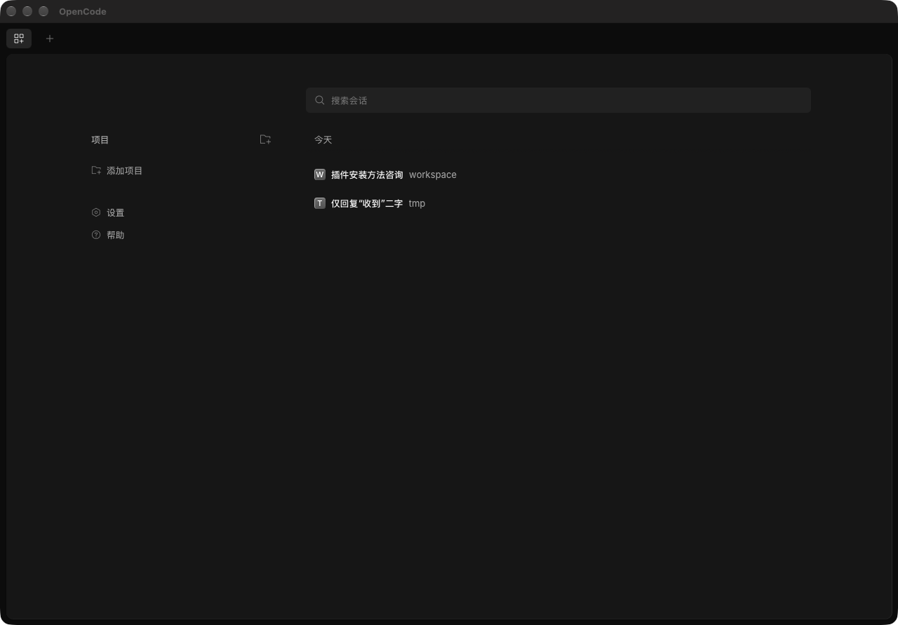

# opencode-shell

**给 opencode Web UI 的 macOS 原生壳：612 KB，不打包 Chromium。**



官方桌面端是 Electron（macOS arm64 dmg 约 144 MB，内置 Chromium 与 Node）。本项目走另一条路：**壳只有 612 KB**（Swift 二进制 152 KB），用系统自带 WKWebView 渲染同一个 Web UI，服务交给 launchd 常驻。关掉窗口、退出前台都不影响服务，红叉是"隐藏"而不是"关闭"。

| | 官方桌面端 | opencode-shell |
|---|---|---|
| 体积 | ~144 MB（Electron） | **612 KB** |
| 渲染引擎 | 自带 Chromium | 系统 WKWebView |
| 服务 | 内置 Node，随 app 退出 | launchd `ai.opencode.web` + supervisor 探活 |
| 红叉 | 关窗口 | 隐藏窗口（Dock 不留缩略图），点图标恢复 |
| 依赖 | 自带运行时 | 已装的 `opencode` CLI |

## 为什么不是"Electron 版更好"

上游 2.0 从 Tauri 换到 Electron 是有理由的：WebKit 在 macOS/Linux 上渲染表现不一致，而且他们要把服务塞进 Electron 的 Node 进程里。**本项目不解决那两个问题**——它只服务一个场景：*macOS 单机、已经装了 `opencode` CLI、只想要一个轻窗口*。在这个前提下，用系统 WebView + launchd 能把壳压到几百 KB，代价是放弃跨平台一致性和内置运行时。

如果你要跨平台、要多标签并行会话，用官方桌面端。

## 结构

```
launchd ai.opencode.web
  └─ supervisor.sh（前台常驻，20s 探活，挂了重拉）
        └─ opencode service start → http://127.0.0.1:49374

opencode.app
  ├─ Contents/MacOS/opencode   Swift 原生壳（NSWindow + WKWebView）
  │     ├─ 调 Contents/Resources/launcher.sh --url 等服务就绪 + 取 pair 链接
  │     ├─ WKWebView 加载该链接（服务端 302 + Set-Cookie，种 30 天会话）
  │     └─ 红叉/⌘W = orderOut 隐藏；Dock 图标 = 恢复
  └─ Contents/Resources/launcher.sh  只负责 ensure + 打印 URL
```

## 要求

- macOS 12+（在 macOS 27 / Apple Silicon 上验证）
- `opencode` CLI 已安装（`npm i -g @opencode/cli` 或 `brew install anomalyco/tap/opencode`）
- Xcode Command Line Tools（`xcode-select --install`，需要 `swiftc`）

## 安装

```bash
git clone https://github.com/jimmywuxin/opencode-shell.git
cd opencode-shell
bash build.sh
open ~/Applications/opencode.app
```

`build.sh` 做四件事：生成图标（10 档 iconset）、编译原生壳并组装 `opencode.app`、安装 `supervisor.sh` 到 `~/.local/share/opencode/`、渲染 launchd plist 到 `~/Library/LaunchAgents/`。

可选环境变量：

| 变量 | 默认 | 用途 |
|---|---|---|
| `OPENCODE_BIN` | 自动探测 | 指定 `opencode` 可执行文件（PATH 找不到时用） |
| `OPENCODE_APP_DIR` | `~/Applications` | 产物安装目录 |

CLI 探测顺序：`OPENCODE_BIN` → `PATH` → `~/.npm-global/bin` → `~/.opencode/bin` → `~/.local/bin` → `/opt/homebrew/bin` → `/usr/local/bin`。

## 窗口行为

| 操作 | 行为 |
|---|---|
| 红叉 / `⌘W` | 隐藏窗口：桌面消失、**Dock 不留缩略图**、应用继续运行、页面状态不丢 |
| 点 Dock 图标 | 窗口恢复 |
| 黄点 / `⌘M` | 标准最小化（Dock 右侧缩略图） |
| `⌘Q` | 真正退出（服务不受影响） |
| `⌘R` | 重新连接（重新 ensure + 重取 pair URL） |
| `⌘+` / `⌘-` / `⌘0` | 缩放 |
| 窗口 → 显示主窗口 | 隐藏后的兜底入口 |

还补齐了 WKWebView 不会自动给的能力：`<input type=file>` → `NSOpenPanel`、`window.open`/`target=_blank` → 同源本窗口、外链 → 系统浏览器、下载 → `NSSavePanel`、媒体权限 `.deny`、Safari「开发」菜单可检查（`isInspectable`）。

## 日常操作

```bash
launchctl print gui/$(id -u)/ai.opencode.web   # 服务状态
launchctl bootout gui/$(id -u)/ai.opencode.web # 停服务（pkill 会被 KeepAlive 复活）
opencode service status                        # opencode 视角
tail -20 ~/.local/share/opencode/log/shell.log # 壳的日志（不含 URL/token）
```

## 配置

- **端口**：固定 `49374`（opencode 托管服务的默认端口）。改端口要同步 `src/supervisor.sh` 的 `PORT`、`src/ShellApp.swift` 的 `baseURL` 与同源判定、`build.sh` 渲染的 plist。
- **日志**（`~/.local/share/opencode/log/`）：`shell.log`（0600，壳）、`supervisor.log`、`opencode.log`、`web.err.log`。
- 壳只记 `ensure exit=`、URL **长度**、页面标题、cookie 名；pair 链接里的 token 等同登录凭据，不落盘，另有 `/auth/connect/<token>` 兜底脱敏。

## 关键取舍（都实测过）

- **红叉必须 `orderOut` + `windowShouldClose` 返回 `false`**：`performMiniaturize` 会留 Dock 缩略图（那是黄点），`NSApp.hide` 会把菜单栏一起藏掉，`close()` 会丢窗口状态。
- **认证走 `opencode pair`**：一次性 `/auth/connect/<token>` 链接，加载后服务端 `302 + Set-Cookie`；不重放旧链接，失败就重新取。
- **cookie 存 `.default()` data store**，否则每次启动都掉登录。
- **ATS 必须放行 loopback**（`NSAllowsLocalNetworking`），否则 WKWebView 直接 `NSURLError`。
- **`launchctl bootstrap` 在 IDE/终端派生的进程里会报 error 5**，只有经 LaunchServices 启动的 `.app` 能 bootstrap——所以 ensure 必须由壳调，`bash build.sh --reload` 要在真终端跑。
- **`service start` 会 daemonize 后退出**，launchd 的 KeepAlive 抓不住 → 需要 `supervisor.sh` 常驻探活。
- **Web UI 未登录时 HTTP 仍是 200**，不能靠状态码判断登录态。

## 卸载

```bash
launchctl bootout gui/$(id -u)/ai.opencode.web
rm -f ~/Library/LaunchAgents/ai.opencode.web.plist
mv ~/Applications/opencode.app ~/.Trash/
```

数据（`~/.config/opencode/`、`~/.local/share/opencode/`）不随卸载删除。

## 非官方声明

本项目是个人自用项目，**不是 opencode 官方产物，与 OpenCode 团队无任何关联**，也未获其背书。"opencode" 仅用于说明本壳所承载的服务。

## License

[MIT](LICENSE)
